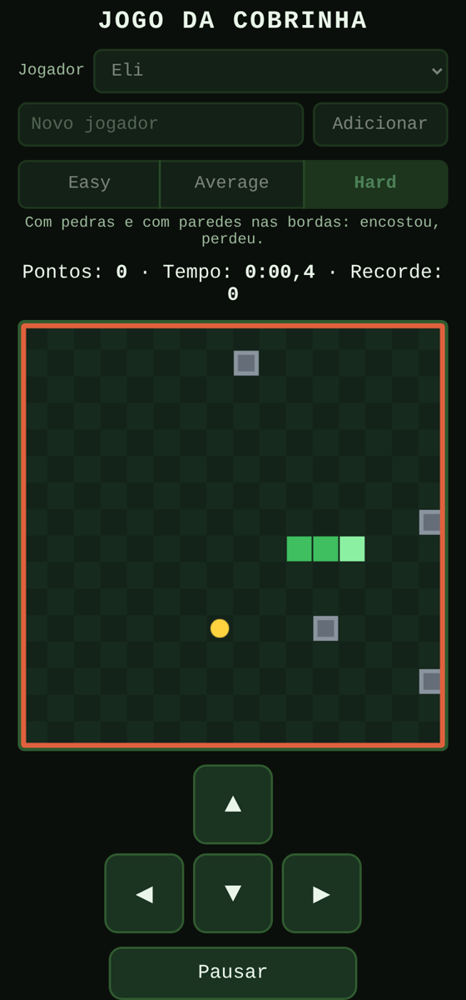
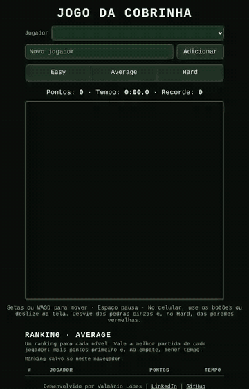

# Jogo da Cobrinha

Jogo da cobrinha em HTML, CSS e JavaScript puro, sem bibliotecas.

**Jogue online:** https://valmario.github.io/Jogo_da_Cobrinha/

  

## Demonstração

Vídeo em MP4 (clique para assistir): [docs/demonstracao.mp4](docs/demonstracao.mp4)

## Como jogar

Abra o `index.html` no navegador.

| Ação | Teclado | Celular |
| --- | --- | --- |
| Mover | Setas ou WASD | Botões na tela ou deslizar o dedo |
| Começar / pausar / jogar de novo | Espaço (ou P) | Botão de ação ou toque simples no jogo |

Os botões na tela só aparecem em telas de toque ou janelas estreitas.

- Coma as bolinhas amarelas para crescer e ganhar pontos.
- Atravessar a borda leva a cobra para o lado oposto.
- Bater no próprio corpo ou numa pedra cinza termina o jogo.
- Começam 4 pedras no tabuleiro, e surge uma nova a cada 4 comidas, até 12. Elas nunca nascem perto da cabeça nem isolam parte do tabuleiro. Os números ficam nas constantes no topo do `script.js`.
- A cobra acelera a cada comida.

## Jogadores e ranking

- **Quem joga:** escolha um jogador na lista para continuar com ele, ou digite um nome novo e clique em **Adicionar** (ou aperte Enter). Se o nome já existir, o jogo continua com aquele jogador. Sem jogador escolhido, a partida não começa.
- **Tempo:** cada partida mede o tempo jogado, sem contar as pausas.
- **Ranking:** vale a melhor partida de cada jogador. Ganha quem faz **mais pontos** e, no empate, quem faz **em menos tempo**. A tela mostra os 10 primeiros, com o jogador atual destacado.
- **Recorde pessoal:** ao terminar a partida, o jogo avisa se você bateu seu recorde (mais pontos, ou os mesmos pontos em menos tempo) e em que posição ficou.
- **Onde ficam os dados:** no navegador de quem joga (`localStorage`). Cada pessoa vê o próprio ranking, e ele não é compartilhado entre aparelhos. É assim que funciona no GitHub Pages e ao abrir o `index.html` direto.

## Ranking compartilhado (banco de dados)

Quando a página roda onde existe um banco de dados da plataforma (a versão publicada como artefato do Claude), o ranking passa a ser **compartilhado**: cada jogador vira um documento na coleção `jogadores` (id = nome em minúsculas, com acentos e espaços convertidos para `~código~`) com `nome`, `melhorPontos`, `melhorTempoMs` e `partidas`. Todos que abrem a página veem o mesmo ranking, ao vivo.

- Quem tem acesso de **colaborador** (ou mais) joga e grava. Quem só visualiza vê o ranking, e o jogo avisa que o resultado não foi salvo.
- Se o banco não existir, não responder ou der erro, o jogo continua funcionando e usa o `localStorage`. Um aviso abaixo da tabela diz de onde vêm os dados.
- Jogadores que já existiam só no navegador sobem para o banco na primeira conexão, se tiverem partida melhor que a do banco.
- Os dados do banco são tratados como não confiáveis: nomes entram como texto puro e os números são limitados.
- O jogo confia nos colaboradores: quem pode gravar pode alterar qualquer pontuação. Para um ranking público e à prova de trapaça, o caminho é um servidor que valide as partidas.

## Como o código está organizado

O `script.js` separa três partes:

1. **Regras** (`novoEstado`, `pedirDirecao`, `avancar`, `sortearComida`, `registrarResultado`, `ordenarRanking`): não mexem na tela, só no estado do jogo e nos jogadores.
2. **Desenho** (`desenhar`, `mensagem`): pinta o estado no canvas.
3. **Controle** (`passo`, `iniciar`, `alternarPausa` e os eventos de teclado e toque): liga as duas anteriores.
